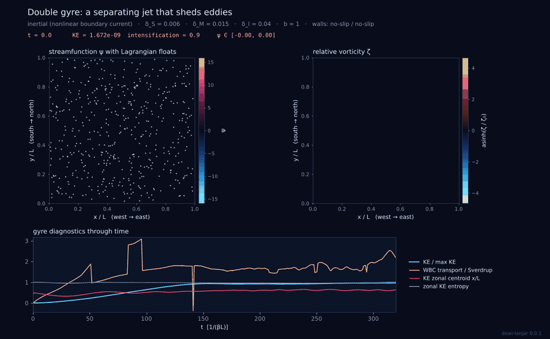
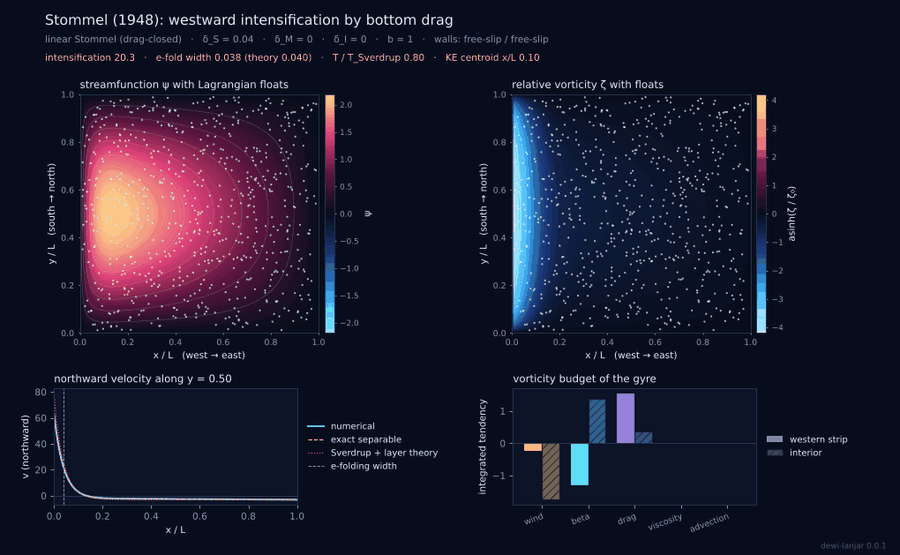
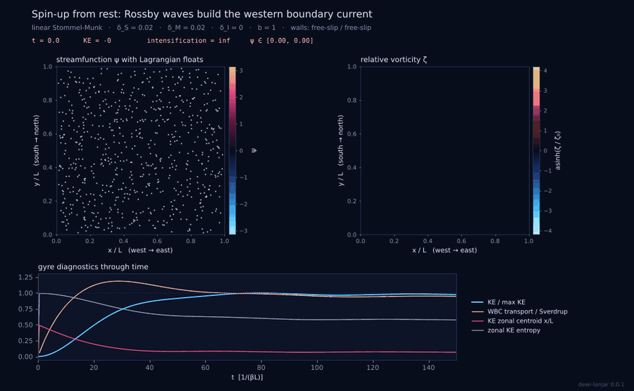
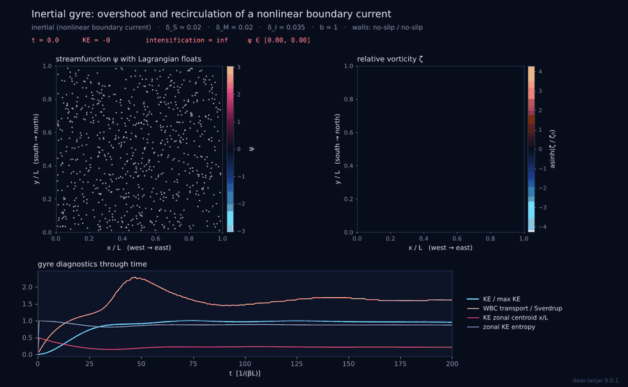
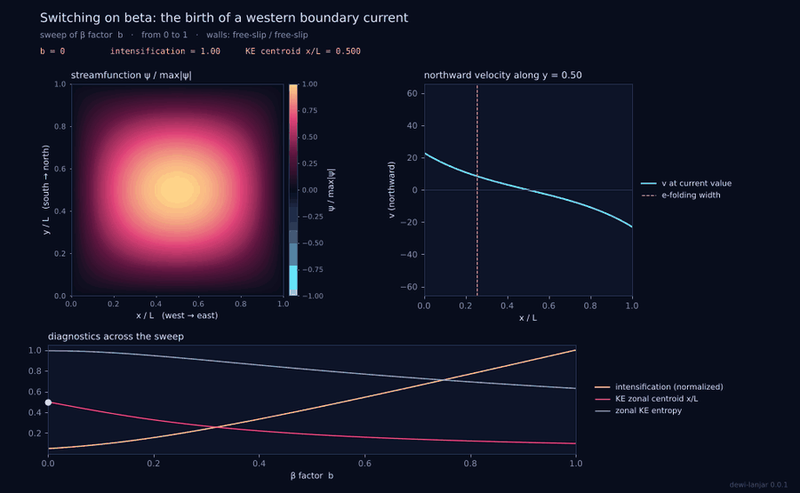

# dewi-lanjar

**Western boundary intensification of wind-driven ocean gyres in Python: Stommel, Munk and inertial boundary currents with rigorous numerics, physical diagnostics and GIF animations.**

[](https://github.com/sandyherho/dewi-lanjar)
[](https://www.python.org/)
[](LICENSE)
[](https://dewi-lanjar.readthedocs.io)
[](https://pytest.org)
[](https://hypothesis.readthedocs.io)
[](https://www.sphinx-doc.org)
[](#use)



Wind drives every ocean basin into a gyre, but the gyre is lopsided: the return
flow is squeezed against the western coast into a narrow, fast current (Gulf
Stream, Kuroshio, Agulhas, Brazil, East Australian Current) while the eastern
side drifts slowly. dewi-lanjar solves the barotropic vorticity equation on a
beta plane in a closed basin,

$$\partial_t\zeta + \delta_I^2 J(\psi,\zeta) + b\,\partial_x\psi = F - \delta_S\zeta + \delta_M^3\nabla^2\zeta,\qquad \zeta=\nabla^2\psi,$$

from the linear problems of Stommel (1948) and Munk (1950) to inertial
recirculations and eddy-shedding double-gyre jets, and explains every step.
Here $\delta_S$, $\delta_M$ and $\delta_I$ are the Stommel, Munk and inertial
boundary-layer widths divided by the basin width, and $b$ switches the
planetary vorticity gradient on (1) or off (0, the f-plane control).

Named after Dewi Lanjar, in Javanese folklore the spirit queen of the sea off
the northern coast of Java.

## What makes it rigorous

| Component | How dewi-lanjar does it |
|---|---|
| Reference solution | Exact separable solution of the steady linear problem for any sine-series wind, any mix of drag and viscosity, free- or no-slip western/eastern walls (characteristic quartic, overflow-free exponential basis). Checked against a 50-digit evaluation of Stommel's closed form to 1e-11. |
| Steady solver | One sparse direct solve with exactly the operators of the time stepper. Second-order convergence verified in every configuration (`dewi-lanjar validate`). |
| Advection | Arakawa (1966) Jacobian: discrete energy (and enstrophy) conservation verified to round-off on random fields, so no nonlinear instability. |
| Poisson problem | Exact inversion of the five-point Laplacian by the type-I discrete sine transform. |
| Time stepping | SSP-RK3 with an adaptive step from advective, Rossby-wave, viscous and drag stability limits; output times hit exactly. A long linear integration reproduces the steady solver to 1e-13. |
| Wall conditions | Free slip (zeta = 0) or no slip (Thom formula), set separately for western/eastern and southern/northern walls. |
| Budgets | Energy and vorticity budgets evaluated with the solver's own inner product: they close to round-off (1e-12 to 1e-15 in steady states). |
| Theory comparison | Boundary-layer widths from the local layer equation `dM^3 m^3 - dS m - b = 0`, measured on the theory profile and the model with the same algorithm. Reproduces delta_S, 2 pi delta_M / sqrt(3) and 4 pi delta_M / (3 sqrt(3)) to 1e-8. |
| Honesty about resolution | Points per boundary layer and the grid-scale fraction of vorticity are reported with warnings, because a bounded eddying run is not necessarily a resolved one. |

## A few numbers worth knowing

From `python tools/validation_report.py`:

- **Second order everywhere.** Doubling the grid from 128 to 256 cells cuts
  the error against the exact solution by a factor of 4.00 for Stommel, Munk
  (free and no slip), mixed Stommel-Munk double gyres and the f plane.
- **Beta is the whole story.** With beta switched off the Stommel gyre is
  exactly symmetric (intensification index 1.000, kinetic-energy centroid
  0.500). With beta on, the same wind and drag give an intensification index
  of about 20 and put the energy centroid at one tenth of the basin width.
- **Two balances, one gyre.** In the steady Stommel-Munk double gyre
  (delta_S = delta_M = 0.02) friction in the western strip (+1.35) offsets the beta
  term (-1.18) and the local wind (-0.17), while in the interior beta takes up
  two thirds of the wind input and friction the rest; each regional budget closes to 1e-12.
- **Munk's counter-current.** For delta_M = 0.03 with no slip, the numerical
  counter-current begins at x = 0.103, about 5 % inside the asymptotic
  2 pi delta_M / sqrt(3) = 0.109; the difference is the interior's own
  southward flow, which the boundary-layer asymptotics neglect.
- **Inertia adds transport.** In the `inertial_gyre` case the boundary current
  carries about 1.6 times the Sverdrup transport because of the northwest
  recirculation.

## Install

```bash
pip install dewi-lanjar
# or from source
git clone https://github.com/sandyherho/dewi-lanjar && cd dewi-lanjar && pip install .
```

Python 3.10 or newer; depends on NumPy, SciPy, Matplotlib and Pillow. No GUI and
no display needed (Agg backend).

## Use

### Command line

```bash
dewi-lanjar list                                    # twelve built-in cases
dewi-lanjar run stommel_1948                        # -> outputs/stommel_1948/{gif,png,summary.txt,...}
dewi-lanjar run inertial_gyre --set physics.delta_i=0.05 --set grid.nx=256 --set grid.ny=256
dewi-lanjar init my_gyre.toml --template double_gyre_eddies && dewi-lanjar run my_gyre.toml
dewi-lanjar steady --delta-s 0.02 --delta-m 0.03 --bc no-slip --bc-ns free-slip --why
dewi-lanjar scales --L 6000 --lat 35 --r 1e-6 --A-h 2000   # ocean -> widths, with numbers substituted
dewi-lanjar widths --delta-m 0.03 --bc no-slip             # boundary-layer roots and widths
dewi-lanjar validate                                       # convergence table
dewi-lanjar explain munk                                   # derivation in the terminal
```

Every run writes the animation, a figure, `summary.txt` with all diagnostics
(in sverdrups, kilometers and meters per second when dimensional scales are
given), `diagnostics.json`, `fields.npz` and the resolved `case.toml`.

### Python

```python
from dewi_lanjar import Grid, Params, WindForcing, solve_steady, exact_linear, diagnostics

grid = Grid(192, 192)
p = Params(delta_s=0.02, delta_m=0.03, bc="no-slip", bc_ns="free-slip")
wind = WindForcing("double-gyre")

sol = solve_steady(grid, p, wind)
exact = exact_linear(grid.X, grid.Y, p, wind)["psi"]
d = diagnostics.compute(sol.psi, sol.zeta, grid, p, wind)
print(diagnostics.describe(d))
```

```python
from dewi_lanjar import TransientSolver, RunConfig

p = Params(delta_s=0.02, delta_m=0.02, delta_i=0.035, bc="no-slip")
run = TransientSolver(Grid(192, 192), p, WindForcing()).run(
    RunConfig(t_end=200, n_frames=100, n_floats=500))
run.series["KE"], run.final["transport_ratio"]
```

## Cases

| case | kind | what it shows |
|---|---|---|
| `stommel_1948` | steady | drag-closed gyre, dimensional values from a 5000 km basin |
| `munk_1950` | steady | viscous layer with its offshore counter-current |
| `f_plane_control` | steady | no beta, no intensification |
| `southern_hemisphere` | steady | anticlockwise gyre, still western-intensified |
| `asymmetric_double_gyre` | steady | unequal gyres, each with its own boundary current |
| `beta_emergence` | sweep | the boundary current forms as beta grows from zero |
| `munk_narrowing` | sweep | sharper current as viscosity falls |
| `stommel_munk_spinup` | transient | Rossby waves build the boundary current from rest |
| `pulsating_wind` | transient | periodic wind, basin Rossby waves, lagging transport |
| `inertial_gyre` | transient | overshoot and northwest recirculation |
| `inertial_runaway` | transient | free-slip walls: a basin-filling inertial mode |
| `double_gyre_eddies` | transient | separating jet that meanders and sheds eddies |

| | |
|---|---|
|  |  |
|  |  |

## Testing

```bash
pip install -e ".[test]"
pytest                    # operators, exact solution, solvers, diagnostics, CLI
pytest -m "not slow"
python tools/validation_report.py
```

What is tested, among others: Arakawa conservation and antisymmetry on random
grids (Hypothesis); exactness of the sine-transform Poisson solver; the exact
solution against 50-digit arithmetic and against its own ODE and wall
conditions for random parameters; second-order convergence of the steady
solver; convergence of the time integration to the steady solution; energy
conservation without forcing and friction; closure of the energy budget in
time; f-plane symmetry; hemispheric mirror symmetry; Munk widths against
theory; floats following streamlines; every built-in case and CLI command.

## Scope and limitations

- One homogeneous layer: no stratification, topography, realistic coastlines
  or observed winds. The results are those of the idealized problem.
- Uniform grid; keep three or more points per boundary-layer decay scale and
  watch the grid-scale fraction in eddying runs.
- The exact solution needs free-slip southern and northern walls when lateral
  friction is present (set `bc_ns = "free-slip"`).
- The steady solver is linear; nonlinear states come from time integration.

## Documentation

Full documentation (installation, quick start, case gallery, CLI, case-file
reference, theory with every derivation, numerical methods, diagnostics,
validation, API) is built with Sphinx for Read the Docs from `docs/`:

```bash
pip install -r docs/requirements.txt && sphinx-build -b html docs docs/_build/html
```

## Authors

Sandy H. S. Herho, Rima Rachmayani, Rusmawan Suwarman, Dasapta E. Irawan

## Citing

See [`CITATION.cff`](CITATION.cff).

## References

- Arakawa, A. (1966). Computational design for long-term numerical integration of the equations of fluid motion: Two-dimensional incompressible flow. Part I. *J. Comput. Phys.* 1(1), 119–143. https://doi.org/10.1016/0021-9991(66)90015-5
- Gottlieb, S., Shu, C.-W., Tadmor, E. (2001). Strong stability-preserving high-order time discretization methods. *SIAM Rev.* 43(1), 89–112. https://doi.org/10.1137/S003614450036757X
- Munk, W. H. (1950). On the wind-driven ocean circulation. *J. Meteorol.* 7(2), 80–93. https://doi.org/10.1175/1520-0469(1950)007<0080:OTWDOC>2.0.CO;2
- Pedlosky, J. (1996). *Ocean Circulation Theory*. Springer. https://doi.org/10.1007/978-3-662-03204-6
- Shu, C.-W., Osher, S. (1988). Efficient implementation of essentially non-oscillatory shock-capturing schemes. *J. Comput. Phys.* 77(2), 439–471. https://doi.org/10.1016/0021-9991(88)90177-5
- Stommel, H. (1948). The westward intensification of wind-driven ocean currents. *Trans. AGU* 29(2), 202–206. https://doi.org/10.1029/TR029i002p00202
- Sverdrup, H. U. (1947). Wind-driven currents in a baroclinic ocean. *PNAS* 33(11), 318–326. https://doi.org/10.1073/pnas.33.11.318
- Vallis, G. K. (2017). *Atmospheric and Oceanic Fluid Dynamics*, 2nd ed. Cambridge University Press. https://doi.org/10.1017/9781107588417

## License

MIT. Copyright © 2026 Applied Geology Research Group, Bandung Institute of Technology.
