# Case gallery

Run any case with `dewi-lanjar run <name>`; print its configuration with
`dewi-lanjar show <name>`. The animations below were produced by
`python tools/make_gallery.py` (smaller copies of the full-resolution GIFs
that `dewi-lanjar run` writes).

## Steady linear gyres

### `stommel_1948`: bottom drag

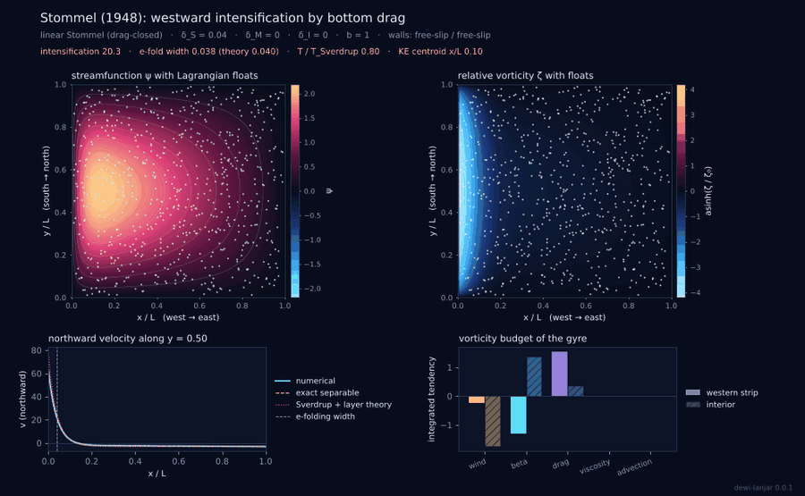

The drag-closed gyre of Stommel (1948), with dimensional values derived from
a 5000 km basin, $\beta = 2\times10^{-11}$ m$^{-1}$ s$^{-1}$ and
$r = 4\times10^{-6}$ s$^{-1}$ ($\delta_S = 0.04$, a 200 km layer). Floats
crawl south through the broad interior and race north in the boundary
current. The velocity section shows the numerical solution on top of the
exact separable solution, and the bar chart shows the two vorticity balances:
wind against beta in the interior, beta against drag in the western strip.

### `munk_1950`: lateral viscosity

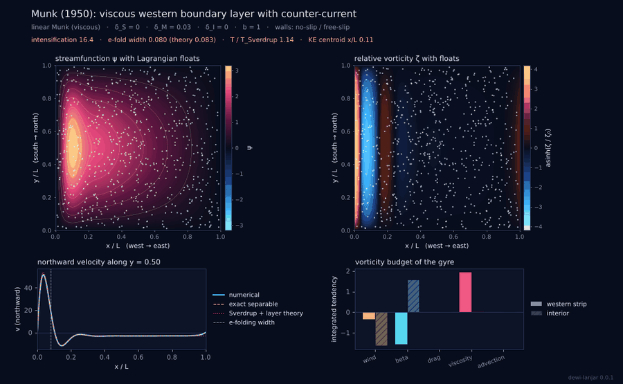

Viscous closure with no slip on the western and eastern walls. The
oscillatory Munk layer has a weak southward counter-current offshore of the
boundary current, first reached at $x = 2\pi\delta_M/\sqrt3$.

### `f_plane_control`: no beta

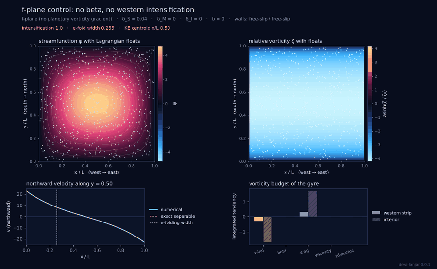

The Stommel case with $\beta = 0$. The gyre is symmetric: intensification
index one, kinetic-energy centroid at mid-basin. The planetary vorticity
gradient alone breaks the symmetry.

### `southern_hemisphere`

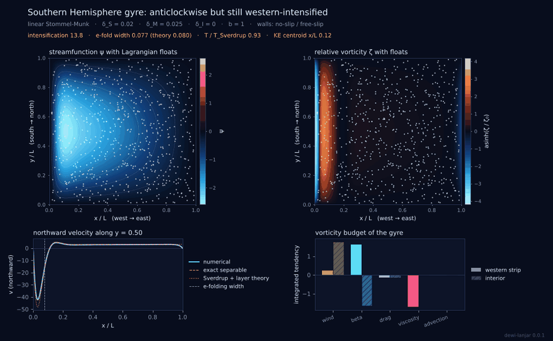

Mirrored wind: the gyre turns anticlockwise and the boundary current flows
south, but it still hugs the western wall because $\beta > 0$ in both
hemispheres.

### `asymmetric_double_gyre`

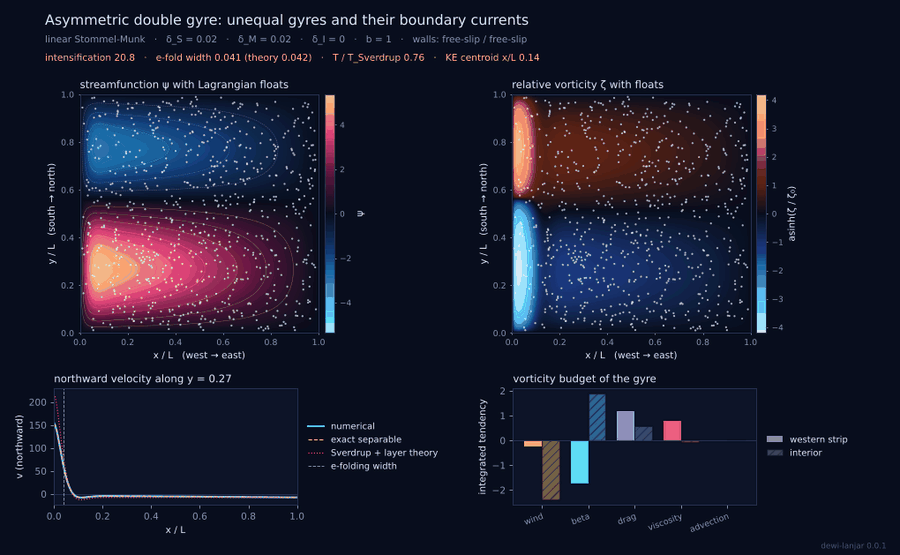

A stronger subtropical gyre and a weaker subpolar gyre, each with its own
western boundary current carrying its own Sverdrup transport.

## Parameter sweeps

### `beta_emergence`: switching on beta

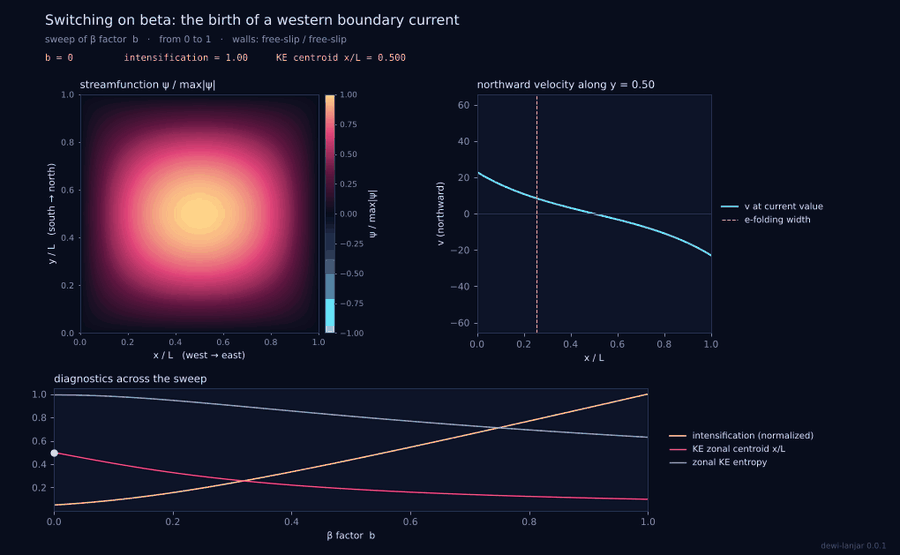

Steady solutions while $b$ grows from 0 to 1. The gyre center migrates west,
the boundary current sharpens, and the zonal kinetic-energy entropy and
centroid fall: the asymmetry grows continuously from the f-plane state.

### `munk_narrowing`

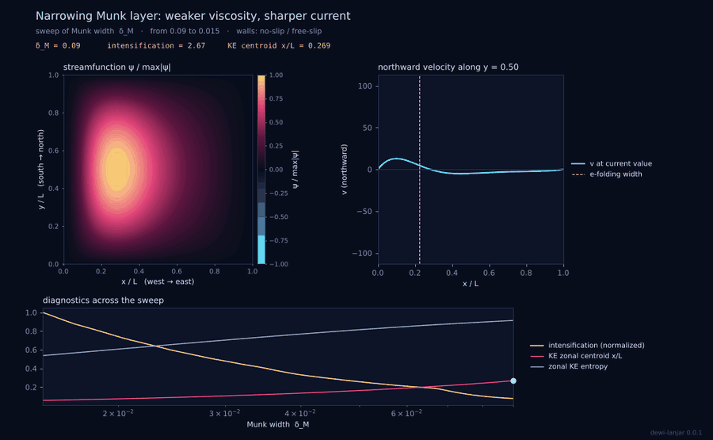

$\delta_M$ falls from 0.09 to 0.015. The current narrows as $\delta_M$, its
peak speed grows as $1/\delta_M$ and the counter-current tracks theory.

## Time-dependent runs

### `stommel_munk_spinup`: Rossby waves build the current

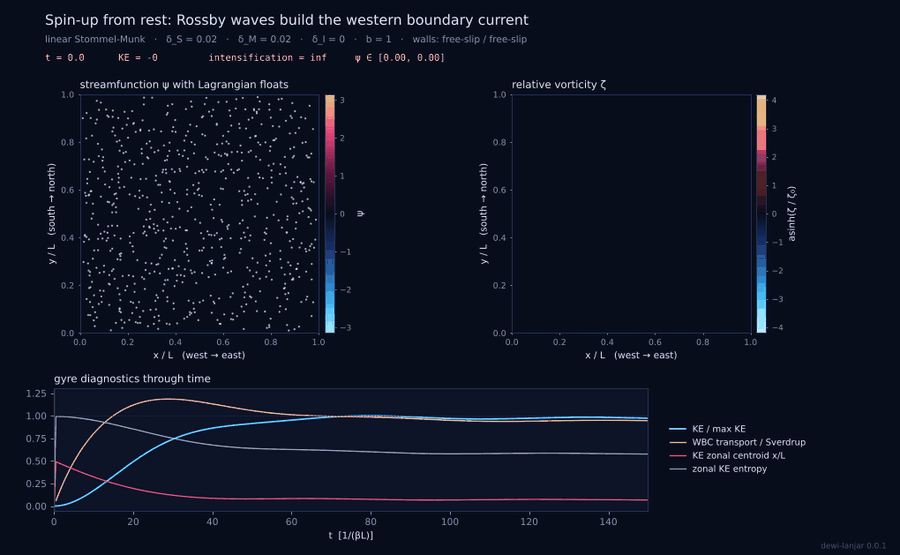

Started from rest. Long Rossby waves leave the eastern wall and set up the
Sverdrup interior as they cross the basin westward; energy piles up at the
western wall into the boundary current, and the gyre settles onto the steady
solution on the drag time.

### `pulsating_wind`

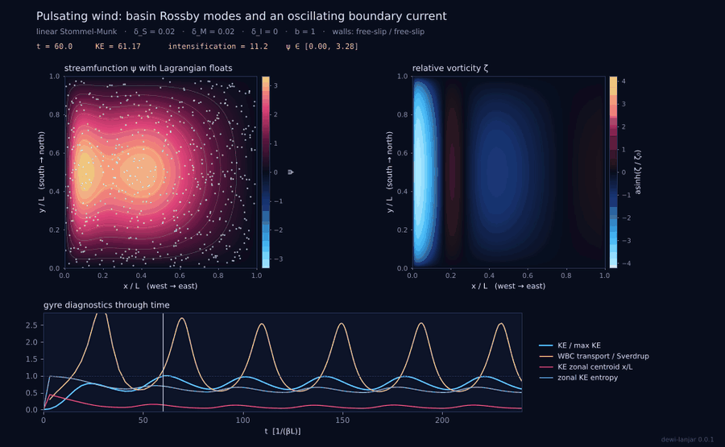

The wind is modulated by $\pm60\%$ with a period comparable to the Rossby
transit time. The interior lags the wind, westward-propagating waves fill the
basin, and the boundary-current transport oscillates out of phase with the
local Sverdrup transport.

### `inertial_gyre`: overshoot and recirculation

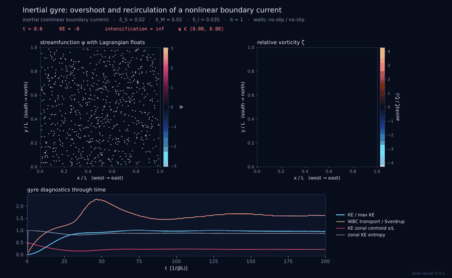

$\delta_I = 0.035 > \delta_M = \delta_S = 0.02$ with no-slip walls. The
boundary current overshoots north and closes in a strong recirculation in
the northwest; the gyre center moves north and the boundary-current
transport exceeds the Sverdrup value.

### `inertial_runaway`: free slip lets the gyre fill the basin

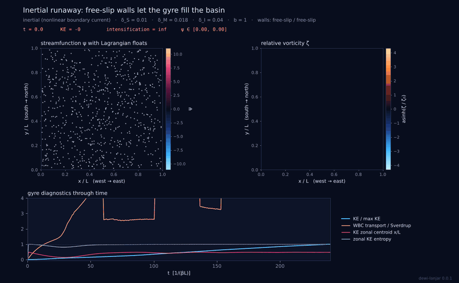

The same kind of inertial parameters with free-slip walls. The circulation
grows into a basin-filling inertial mode near Fofonoff's free solution, the
kinetic energy keeps rising and the western intensification is lost.

### `double_gyre_eddies`: a separating, eddy-shedding jet

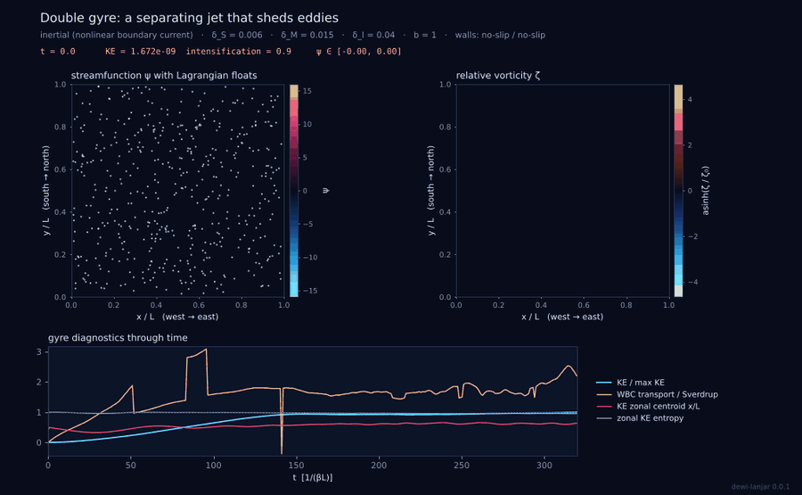

Subtropical and subpolar boundary currents meet and leave the coast as a
free jet that meanders, forms recirculation vortices and sheds eddies; the
flow never becomes steady. A small seeded perturbation breaks the exact
symmetry of the forcing.

## Making your own

Any field of any case can be changed (`--set section.key=value`), and
`dewi-lanjar init my.toml --template <case>` writes a file to edit. The
[case file reference](case-files.md) lists every key.
