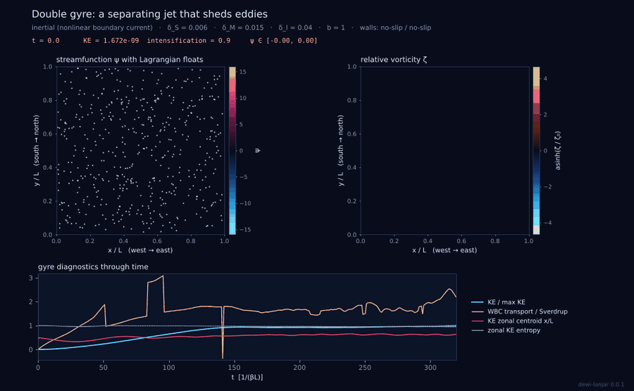

# dewi-lanjar

**Western boundary intensification of wind-driven ocean gyres, from Stommel
and Munk to inertial and eddying double gyres, with rigorous numerics,
physical diagnostics and GIF animations.**



Wind drives every ocean basin into a gyre, but the gyre is lopsided: the
return flow is squeezed against the western coast into a narrow, fast current
(the Gulf Stream, Kuroshio, Agulhas, Brazil and East Australian Currents)
while the eastern side drifts slowly. dewi-lanjar solves the barotropic
vorticity equation on a $\beta$ plane in a closed basin and shows why.

* **A library and a command-line tool, no GUI.** `pip install dewi-lanjar`,
  then `dewi-lanjar run stommel_1948`.
* **Twelve ready-made cases** (steady, time-dependent and parameter sweeps),
  each producing a GIF animation, a figure, a diagnostic report and the data.
  Every parameter can be changed from the command line or in a TOML file.
* **Gold-standard numerics, verified.** Arakawa energy-conserving Jacobian,
  exact sine-transform Poisson solver, SSP-RK3 time stepping and a sparse
  direct steady solver, checked against an exact separable solution that
  converges at second order.
* **Physically meaningful diagnostics.** Energy and vorticity budgets that
  close to round-off, boundary-layer widths compared with theory, transport
  closure against Sverdrup, and energy-concentration measures (zonal
  centroid, Shannon entropies).
* **Every equation derived.** The [theory](theory.md) page and
  `dewi-lanjar explain <topic>` go from the momentum equations to the
  boundary layers step by step.

Named after Dewi Lanjar, in Javanese folklore the spirit queen of the sea off
the northern coast of Java.

```{toctree}
:maxdepth: 2
:caption: Using dewi-lanjar

installation
quickstart
cases
cli
case-files
```

```{toctree}
:maxdepth: 2
:caption: Science

theory
numerics
diagnostics
validation
```

```{toctree}
:maxdepth: 2
:caption: Reference

api
references
about
```
